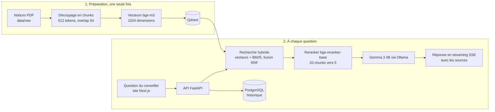

# DépannIA

Assistant de dépannage pour les conseillers du service après-vente d'électroménager : il cherche dans les notices PDF des appareils et répond en 5 étapes maximum, avec la page de la notice citée.

Projet Fédérateur BD-BI-3 · Axe RAG hybride · Équipe : Ahmed et Achref.

## Vision produit

- **Utilisateur :** le conseiller du service après-vente (persona : Sami), qui répond aux appels des clients.
- **Problème :** pour chaque appel (« mon lave-vaisselle affiche E:02 »), il doit trouver la notice du bon modèle parmi des centaines de PDF, puis la bonne page : environ 5 à 10 minutes par appel (estimation). Une erreur peut faire déplacer un technicien pour rien.
- **Solution :** DépannIA cherche dans la notice du bon modèle (recherche hybride : par le sens et par les mots exacts), garde les 5 meilleurs passages et rédige la solution en 5 étapes maximum, chaque étape citant sa page.
- **Garde-fou :** si la notice ne contient pas la réponse, DépannIA répond « la notice ne permet pas de conclure » au lieu d'inventer.
- **Objectifs mesurés :** Recall@5 ≥ 80 %, Faithfulness ≥ 0,85, Answer Relevance ≥ 0,80, premier mot affiché en moins de 0,8 s.

## Schéma d'architecture initial



## Matrice des responsabilités

| Livrable | Séance | Responsable | En appui |
| :--- | :-: | :--- | :--- |
| Fiche de cadrage et backlog MoSCoW | 1 | Ahmed | Achref |
| Notices dans `data/raw/`, `docker-compose.yml` avec Qdrant | 1 → 2 | Ahmed | Achref |
| Ingestion : découpage, vecteurs, indexation dans Qdrant | 2 | Ahmed | Achref |
| Recherche hybride, reranker, évaluation Ragas | 3 | Ahmed | Achref |
| API FastAPI, streaming SSE, historique PostgreSQL | 4 | Achref | Ahmed |
| Site Next.js : discussion, sources, bouton Stop | 5 | Ahmed et Achref | — |
| Tests Pytest et GitHub Actions | 6 | Achref | Ahmed |
| Docker de production et soutenance | 7 | Ahmed et Achref | — |

Rôles : Ahmed est Lead Data / Retrieval, Achref est Lead Backend / MLOps, et le Frontend / Infra est partagé.

## Contenu du dépôt

- `fiche_cadrage_projet.md` : fiche de cadrage
- `matrice_moscow_backlog.md` : backlog MoSCoW
- `choix_base_vectorielle.md` : choix argumenté de la base vectorielle
- `docker-compose.yml` : lance la base vectorielle Qdrant
- `data/raw/` : les notices PDF

## Lancer la base vectorielle

```bash
docker compose up -d
```

Puis ouvrir le tableau de bord : http://localhost:6333/dashboard

## Sécurité

Le fichier `.env` n'est jamais envoyé sur GitHub : il est listé dans `.gitignore`.
