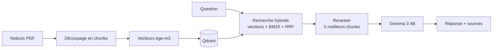

# DépannIA

Assistant de dépannage pour les conseillers du service après-vente d'électroménager : il cherche dans les notices PDF des appareils et répond en 5 étapes maximum, avec la page de la notice citée.

Projet Fédérateur BI-AI-3 · Axe RAG hybride.

## Architecture prévue

## Contenu du dépôt

- `fiche_cadrage_projet.md` : fiche de cadrage
- `matrice_moscow_backlog.md` : backlog MoSCoW
- `data/raw/` : les notices PDF, ajoutées avant la séance 2

## Équipe

| Membre | Rôles |
| :--- | :--- |
| Ahmed | Data / Retrieval, Backend / MLOps, Frontend / Infra |

## Sécurité

Le fichier `.env` n'est jamais envoyé sur GitHub : il est listé dans `.gitignore`.
